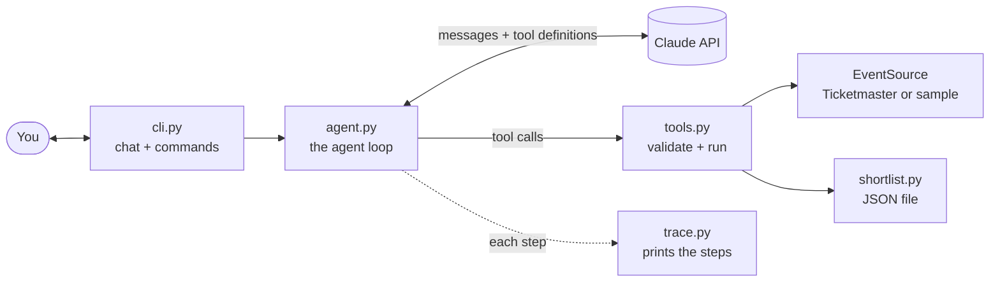

# Event Scout

A terminal agent that finds concerts and live events. Ask a question in plain English, and it decides which tools to call, runs them, reads the results, and answers.

It's built on a **hand-written tool-use loop** over the Claude API, with no agent framework, so every part of how an AI agent works is visible in code you can read in one sitting.

## What it does

- Understands requests like *"Any indie rock in Chicago in the next two weeks under $60?"*, including relative dates and budgets.
- Chooses its own tools: search events, get event details, save to a shortlist, list the shortlist.
- **Shows its work**: every step prints the model's reasoning summary, each tool call and result, and token usage with an estimated cost.
- Uses real events from the [Ticketmaster Discovery API](https://developer.ticketmaster.com/products-and-docs/apis/discovery-api/v2/), or a bundled offline dataset when no Ticketmaster key is set.
- Keeps a shortlist of saved events between sessions.

## Example

What the step-by-step trace looks like. This output comes from the offline test harness (a scripted fake Claude); a live run prints the same format.

```
you> Any indie rock in Chicago in the next two weeks under $60?
-- step 1 ------------------------------- sending 1 message
  thinking   The user wants indie rock in Chicago in the next two weeks, under $60. Today is Nov 3,
             so the window ends Nov 17.
  tool call  search_events {"keyword": "indie rock", "city": "Chicago", "start_date": "2026-11-03",
             "end_date": "2026-11-17"}
  usage      stop_reason=tool_use | prompt 2,140 (0 cached) | output 180 | ~$0.0122
  result     ok, 501 chars: {"count": 2, "events": [{"id": "sample-001", "name": "Velvet Static with
             Kestrel Moon", "date": "2026-11-06", "time": "20:00", "venue": "The Lantern Room", ...
-- step 2 ------------------------------ sending 3 messages
  thinking   Two shows. Velvet Static is $25-40, under budget. Marigold Engine is $55-75, which goes
             over $60.
  usage      stop_reason=end_turn | prompt 2,690 (2,140 cached) | output 210 | ~$0.0068
-- done in 2 steps: 4,830 prompt tokens (2,140 cached), 390 output tokens, ~$0.0190

Velvet Static with Kestrel Moon, Fri Nov 6, 8pm, The Lantern Room, $25-40 ...
```

## Quick start

You need Python 3.12+ and [uv](https://docs.astral.sh/uv/).

```bash
uv sync                    # install dependencies into .venv
cp .env.example .env       # then put your ANTHROPIC_API_KEY in .env
uv run event-scout         # start chatting
```

Ask a single question and exit:

```bash
uv run event-scout "What jazz is on in New York this week?"
```

- **API key:** create one at [platform.claude.com](https://platform.claude.com/settings/keys). A typical question costs about 1 to 3 cents with the default model.
- **Live events (optional):** get a free key at [developer.ticketmaster.com](https://developer.ticketmaster.com) and set `TICKETMASTER_API_KEY` in `.env`. Without it, the app uses the offline sample data, which covers Chicago, New York, Austin, Los Angeles, Seattle, Toronto, and London.

## Commands and options

In the chat:

| Command | What it does |
|---|---|
| `/shortlist` | Show your saved events (no AI call) |
| `/history` | Print the raw conversation the API sees, as JSON |
| `/reset` | Start a new conversation (the shortlist is kept) |
| `/help`, `/quit` | Help, and exit (Ctrl-D also exits) |

On the command line:

| Option | Default | What it does |
|---|---|---|
| `--effort {low,medium,high,xhigh,max}` | `medium` | How hard the model thinks: lower is faster and cheaper |
| `--model MODEL` | `claude-opus-5-5` | Which Claude model to use |
| `--offline` | off | Use the sample data even if a Ticketmaster key is set |
| `--quiet` / `--verbose` | neither | Hide the trace / show full thinking and tool results |
| `--max-steps N` | `10` | Most model calls allowed per question |
| `--no-fallbacks` | off | Don't send the refusal-fallback beta |

## How it works



The core is [`ScoutAgent.ask`](src/event_scout/agent.py#L82). It sends the whole conversation to Claude, and Claude either answers or asks for tools to be run. When it asks for tools, the loop runs them, appends the results to the conversation, and sends it again. This repeats until Claude says it's done (`stop_reason == "end_turn"`) or a step limit is hit.

Claude decides **what** to do; the code decides **what's allowed**. Run `/history` after any question to see the exact messages the loop sent to the API.

## Project layout

```
src/event_scout/
  agent.py          the agent loop: call Claude, run tools, repeat
  tools.py          tool definitions, input validation, and the dispatcher
  prompts.py        the system prompt
  trace.py          prints each step of the loop
  cli.py            terminal chat, commands, and flags
  config.py         model, effort, limits, and prices
  usage.py          token counting and cost estimates
  shortlist.py      saved events, stored as a JSON file
  events/
    models.py       the normalized Event model
    base.py         the EventSource interface every data source implements
    ticketmaster.py Ticketmaster Discovery API client
    sample.py       offline source over sample_events.json (fictional events)
tests/              75 offline tests, using a fake Claude client
```

## Design decisions

- **A hand-written loop instead of a framework.** Frameworks and the SDK's tool runner hide the loop. Writing it out shows exactly what an agent is: about 40 lines of request, check `stop_reason`, run tools, repeat.
- **One `Event` model behind an `EventSource` interface.** Ticketmaster and the offline data both convert into the same shape, so the agent never knows or cares where events come from.
- **Pydantic models define each tool's input.** One model generates the JSON Schema Claude sees *and* validates what Claude sends back, so the two can't drift apart.
- **Tools never raise.** Invalid input, unknown tools, API failures, and bugs all come back to Claude as error results it can read and recover from.
- **Append-only history, fixed per-session prompt.** The conversation is never edited, and the system prompt and tool list never change mid-session. That keeps prompt caching working and satisfies Claude Opus 5.5's check that earlier reasoning wasn't tampered with.
- **Small tool results.** Search returns compact summaries; details are a separate tool. Everything in the conversation is re-sent on every step, so smaller results mean faster, cheaper steps.
- **An observer for output.** The loop never prints. It calls hooks that the trace (or a test) implements.

## Testing

```bash
uv run pytest
```

75 tests run offline in about a second, with no API key. The agent tests use a fake client that replays scripted responses built from the SDK's real response types. They cover the main loop, several tool calls in one reply, error recovery, truncated replies, refusals, the step limit, and the exact request sent to the API.

## Roadmap

- Stream responses token by token
- Rebuild the same agent with the SDK's Tool Runner, and compare
- A small web UI
- An eval set: does the agent pick the right tools for a set of questions?
- Run multiple tool calls concurrently

## Notes

The offline sample events, artists, teams, and venues are fictional, and their ticket links point to `example.com`.
