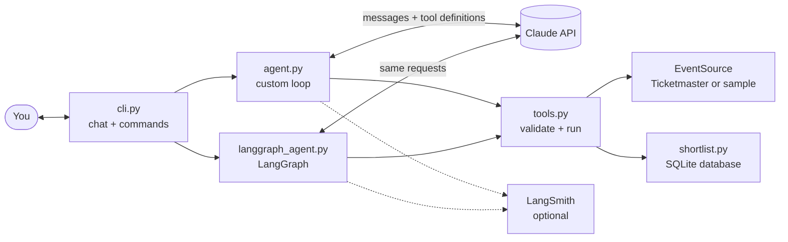

# Event Scout

A terminal agent that finds concerts and live events. Ask a question in plain English, and it decides which tools to call, runs them, reads the results, and answers.

The agent is built twice: once as a **custom tool-use loop** over the Claude API, and once with **LangChain and LangGraph**. Both share the same tools and prompt, are traced with **LangSmith**, and are scored on the same evaluation set. The custom loop keeps every part of how an agent works visible; the second engine shows what a framework takes on and what it hides.

## What it does

- Understands requests like *"Any indie rock in Chicago in the next two weeks under $50?"*, including relative dates and budgets.
- Chooses its own tools: search events, get event details, save to a shortlist, list the shortlist.
- **Shows its work**: every step prints the model's reasoning summary when there is one, each tool call and result, and token usage with an estimated cost.
- Runs on a bundled offline dataset of fictional events, or on the [Ticketmaster Discovery API](https://developer.ticketmaster.com/products-and-docs/apis/discovery-api/v2/) when a key is set.
- Keeps a shortlist of saved events between sessions.

## Example

A live run on Claude Sonnet 5.5 with the offline data:

```
$ uv run event-scout --offline "Any indie rock in Chicago in the next two weeks under \$50?"
-- step 1 ------------------------------- sending 1 message
  tool call  search_events {"city": "Chicago", "keyword": "indie rock", "start_date": "2026-11-04",
             "end_date": "2026-11-18", "category": "music"}
  usage      stop_reason=tool_use | prompt 1,916 (0 cached) | output 153 | ~$0.0063
  result     ok, 501 chars: {"count": 2, "events": [{"id": "sample-001", "name": "Velvet Static with
             Kestrel Moon", "date": "2026-11-07", "time": "20:00", "venue": "The Lantern Room", ...
-- step 2 ------------------------------ sending 3 messages
  usage      stop_reason=end_turn | prompt 2,310 (1,912 cached) | output 212 | ~$0.0035
-- done in 2 steps: 4,226 prompt tokens (1,912 cached), 365 output tokens, ~$0.0098

Only one of the two indie rock shows in Chicago over the next two weeks (Nov 4–18) is under $50:

- Velvet Static with Kestrel Moon: Saturday, Nov 7, 8:00 PM at The Lantern Room, Chicago. Tickets are $25–40 and on sale.

The other show costs more than your limit:
- Marigold Engine: Late Bloom Tour: Friday, Nov 13, 8:30 PM at Halsted Ballroom, Chicago. Tickets are $55–75.
```

## Quick start

You need Python 3.12+ and [uv](https://docs.astral.sh/uv/).

```bash
uv sync                    # install everything, including the LangChain packages and test tools
cp .env.example .env       # then put your ANTHROPIC_API_KEY in .env
uv run event-scout         # start chatting
```

Ask a single question and exit:

```bash
uv run event-scout "What jazz is on in New York this week?"
```

- **API key:** create one at [platform.claude.com](https://platform.claude.com/settings/keys).
- **Cost:** about 1¢ per question at low effort on the default model, Claude Sonnet 5.5, as measured in the evaluation below. Claude Opus 5.5 is available with `--model claude-opus-5-5`, at twice the per-token price.
- **Live events (optional):** get a free key at [developer.ticketmaster.com](https://developer.ticketmaster.com) and set `TICKETMASTER_API_KEY`. Without it, the app uses the offline data, which covers Chicago, New York, Austin, Los Angeles, Seattle, Toronto, and London.
- **Smaller install (optional):** the custom engine needs only `anthropic` and `pydantic`. `uv sync --no-dev` installs just those, and `uv sync --no-dev --extra langchain` adds the LangChain packages.

## Web API

```bash
uv run event-scout-api --offline
```

This starts the API at `http://127.0.0.1:8000`, with interactive documentation at `/docs`. It has no login, so it only accepts connections from your own computer. Questions sent to `POST /api/chat` call Claude and cost the same as in the terminal.

## Commands and options

In the chat:

| Command | What it does |
|---|---|
| `/shortlist` | Show your saved events (no AI call) |
| `/history` | Print the raw conversation the API sees, as JSON |
| `/reset` | Start a new conversation (the shortlist is kept) |
| `/help`, `/quit` | Help, and exit (Ctrl-D also exits) |

On the command line:

| Option | Default | What it does |
|---|---|---|
| `--engine {custom,langgraph}` | `custom` | Which agent loop to run |
| `--effort {low,medium,high,xhigh,max}` | `medium` | How hard the model thinks: lower is faster and cheaper |
| `--model MODEL` | `claude-sonnet-5-5` | Which Claude model to use |
| `--offline` | off | Use the sample data even if a Ticketmaster key is set |
| `--quiet` / `--verbose` | neither | Hide the trace / show full thinking and tool results |
| `--max-steps N` | `10` | Most model calls allowed per question |
| `--no-fallbacks` | off | Don't send the refusal-fallback beta |

## How it works



The core is [`ScoutAgent.ask`](src/event_scout/agent.py#L82). It sends the whole conversation to Claude, and Claude either answers or asks for tools to be run. When it asks for tools, the loop runs them, appends the results to the conversation, and sends it again. This repeats until Claude says it's done (`stop_reason == "end_turn"`) or a step limit is hit. Run `/history` after any question to see the exact messages sent to the API.

[`LangGraphScoutAgent`](src/event_scout/langgraph_agent.py) runs the same cycle through LangChain's `create_agent`, as a graph with a model node and a tools node. Both engines use the same tool definitions, system prompt, and request settings.

## Comparing the engines

```bash
uv run event-scout-eval --list                                # see the questions (free)
uv run event-scout-eval --engine both
```

The evaluation asks 17 questions covering searches, budgets, relative dates, missing information, follow-ups, cancelled events, cases that shouldn't use tools, and a prompt-injection attempt. Each run uses the offline data on a pinned date with an empty shortlist. Answers are graded by plain code, with no AI judge: expected tools, required text, what ended up in the shortlist, and whether prices, links, and event names came from tool results.

**Results** from one run per question, on Claude Sonnet 5.5 at low effort:

| Engine | Passed | Avg steps | Prompt tokens | Output tokens | Cost per question (no cache) | Time per question |
|---|---|---|---|---|---|---|
| Custom | 17/17 | 2.3 | 4,874 | 278 | $0.0125 | 3.7s |
| LangGraph | 17/17 | 2.3 | 4,873 | 277 | $0.0125 | 3.7s |

**What this does and doesn't show:**

- The engines tied, and that's the expected result. They send the same requests to the same model: the LangGraph run read 4,220 of 4,226 prompt tokens from the prompt cache left by the custom run, which requires byte-identical request prefixes. A framework's value isn't better answers here.
- A perfect score means this set has hit its ceiling. It confirms that these 17 behaviors work, but it can't separate the engines or rank settings. That would take harder questions and more runs.
- It's a small sample: with 17 runs per engine, pass-rate differences under about 24 points are within normal variation.
- Caching makes paid cost depend on which engine runs first, so the table shows the cost with no cache discount. With caching, the paid cost was about $0.0065 per question.

### Where the engines differ

Building the same agent twice exposed behavior the framework decides on its own:

| | Custom loop | LangGraph | Handled by |
|---|---|---|---|
| **Parallel tool calls** | Runs them one at a time | Runs them on separate threads, which lost shortlist entries with the original JSON storage (3 of 6 saved) | A lock in `langchain_tools.py` makes both engines run tools one at a time, and saves are now safe in SQLite |
| **Step limit** | Counts model calls | Counts graph steps | `recursion_limit = 2 × max_steps` |
| **Input tokens** | Reported as uncached only | Reported as a total, including cached | Converted in `langgraph_agent.py` |
| **Reply cut off during a tool call** | Refuses to run it | Runs it anyway | Left as is, and recorded in a test |
| **Code size** | 164 lines, not counting blanks and comments | 179 lines, plus a 35-line tool adapter, mostly translating formats | |

The framework removes the loop, but this project needs a custom trace, cost tracking, and identical behavior across engines, and that takes translation code. A plain LangGraph agent without those needs far less.

## Testing on live data

The Ticketmaster client passed its tests against a sample fixture, then failed in ways the fixture couldn't show. Running against the real API found:

| Problem | Effect | Fix |
|---|---|---|
| **Date filters were in UTC** | A search for Saturday in Chicago returned 20 events, 19 of them from Friday, and missed 22 Saturday shows | Filter on the venue's local time: 21 of 21 on the right day |
| **No default start date** | A search with no dates returned an event from 2022 | Default to today |
| **Placeholder prices** | Events with no price set showed as `0 USD`, which reads as free | Treat 0-to-0 ranges as unknown |
| **Result pages fill up fast** | A search over two weeks can match 169 events, and one page shows the earliest 25 at most | Tell the model the page is partial, so it can say so or narrow the search |

Afterward, the agent's answer to *"What concerts are on in Chicago this Saturday under $50?"* matched the source data exactly on both engines: all five priced shows, correct prices, and the cancelled show flagged.

**Known limits with live data:**

- **Most events have no price.** On that Saturday, 16 of 21 shows had none. The agent says it can't confirm those are under budget, so budget answers can be incomplete.
- **Results are limited to one page per search.** There's no paging, so the agent has to narrow its search to see later events.
- **Evaluations don't cover live data.** They always use the offline dataset, so their scores stay comparable, and live checks were done manually.

## Tracing with LangSmith

Tracing is optional and off by default. To turn it on, add your settings from [smith.langchain.com](https://smith.langchain.com) to `.env`, as shown in `.env.example`:

```
LANGSMITH_TRACING=true
LANGSMITH_API_KEY=...
```

Each question then becomes one nested trace, tagged by engine. Add `--langsmith` to the eval command to record the runs as experiments, with a score for every check:

```bash
uv run event-scout-eval --engine both --langsmith
```

Experiments run one engine at a time, so the engine that runs second gets more cache hits. Compare the no-cache cost when using this flag.

With tracing on, prompts, tool results, and answers are sent to LangSmith's servers. Tracing can't affect the app: requests to Claude are identical with it on or off, and a LangSmith failure still returns the answer.

## Project layout

```
src/event_scout/
  agent.py            the custom agent loop
  langgraph_agent.py  the same agent, built with LangGraph
  langchain_tools.py  exposes the tools to LangChain
  tools.py            tool definitions, input validation, and the dispatcher
  prompts.py          the system prompt
  evals.py            runs and grades the evaluation set
  tracing.py          optional LangSmith tracing
  trace.py            prints each step of the loop
  cli.py              terminal chat, commands, and flags
  api.py              web API: chat, shortlist, stats, and health endpoints
  server.py           starts the web API
  config.py           model, effort, limits, and prices
  usage.py            token counting and cost estimates
  db.py               the SQLite database: connections, schema, transactions
  shortlist.py        saved events, stored in SQLite
  runs.py             per-question measurements and the stats query
  events/
    models.py         the normalized Event model
    base.py           the EventSource interface every data source implements
    ticketmaster.py   Ticketmaster Discovery API client
    sample.py         offline source over sample_events.json (fictional events)
evals/dataset.json    the evaluation questions and expectations
tests/                269 offline tests, using fake model clients
```

## Design decisions

- **A custom loop as the reference.** Frameworks and the SDK's tool runner hide the loop. Writing it out shows exactly what an agent is, and gives the framework version something to be measured against.
- **One `Event` model behind an `EventSource` interface.** Ticketmaster and the offline data both convert into the same shape, so the agent never knows or cares where events come from.
- **Pydantic models define each tool's input.** One model generates the JSON Schema Claude sees *and* validates what Claude sends back, so the two can't drift apart.
- **Tools never raise.** Invalid input, unknown tools, API failures, and bugs all come back to Claude as error results it can read and recover from.
- **Append-only history, fixed per-session prompt.** The conversation is never edited, and the system prompt and tool list never change mid-session. That keeps prompt caching working and satisfies the API's check that earlier reasoning wasn't tampered with.
- **Small tool results.** Search returns compact summaries; details are a separate tool. Everything in the conversation is re-sent on every step, so smaller results mean faster, cheaper steps.
- **An observer for output.** The loop never prints. It calls hooks that the trace (or a test) implements, and tracing wraps the engine from outside, so `agent.py` doesn't know about either.

## Testing

```bash
uv run pytest
```

269 tests run offline in a few seconds, with no API key. Fake clients replay scripted responses using the SDK's real response types. The LangGraph tests run the real `ChatAnthropic` and `create_agent` code with only the network call replaced, and many tests run one script through both engines and compare the results.

The grader is tested too: a known-correct answer for every case must pass on both engines, an empty answer must fail every case, wrong answers must be caught, and correct answers in other formats must not be rejected.

**Not yet verified against live services:** Claude Opus 5.5. All live runs used the default, Claude Sonnet 5.5.

## Roadmap

- Harder evaluation questions that can separate engines and settings
- Stream responses token by token
- A small web UI
- Run multiple tool calls concurrently

## Notes

The offline sample events, artists, teams, and venues are fictional, and their ticket links point to `example.com`.
